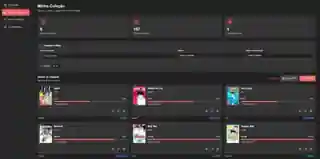
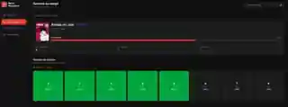

# 📚 Minha Mangateca

<p align="center">
  <strong>Organize sua coleção. Acompanhe cada volume. Planeje suas próximas leituras.</strong>
  <br />
  Uma aplicação web para quem gosta de colecionar mangás e quer manter tudo organizado em um só lugar.
</p>

<p align="center">
  <a href="https://minhamangateca.netlify.app/"><strong>🌐 Acessar aplicação</strong></a>
  &nbsp;·&nbsp;
  <a href="https://github.com/PedroHQCoelho/minhamangateca"><strong>Ver código-fonte</strong></a>
</p>

<p align="center">
  
  
  
  
</p>

---

## ✨ Sobre o projeto

**Minha Mangateca** é uma aplicação web criada para ajudar leitores e colecionadores a gerir suas coleções de mangás. Com ela, é possível cadastrar obras, acompanhar individualmente os volumes adquiridos e faltantes, organizar uma lista de desejos e visualizar estatísticas da coleção.

O projecto foi pensado para oferecer uma experiência simples e intuitiva, com interface responsiva, temas claro e escuro e armazenamento local dos dados.

## 🖥️ Prévia da aplicação

### 1. Dashboard

Acompanhe os principais números da sua coleção, veja o progresso geral e aceda rapidamente aos mangás adicionados.

<p align="center">
  
</p>

### 2. Minha Coleção

Consulte as obras cadastradas, pesquise por título, filtre por editora ou status de publicação e acompanhe o progresso de cada coleção.

<p align="center">
  
</p>

### 3. Detalhes do mangá

Visualize a quantidade total de volumes, os exemplares adquiridos e os que ainda faltam. Actualize o status de cada volume directamente na grade.

<p align="center">
  
</p>

### 4. Lista de desejos

Guarde os títulos que pretende comprar e mantenha suas próximas aquisições organizadas. Quando adquirir uma obra, pode transferi-la para a coleção.

<p align="center">
  
</p>

---

## 🚀 Funcionalidades

- **Gestão da coleção:** cadastre, edite, pesquise e organize seus mangás.
- **Acompanhamento de volumes:** marque individualmente os volumes como adquiridos ou faltantes.
- **Progresso da coleção:** acompanhe quantidades e percentuais de conclusão por obra.
- **Capas personalizadas:** adicione imagens para identificar visualmente seus mangás.
- **Lista de desejos:** mantenha uma lista de títulos que pretende adquirir.
- **Transferência para a coleção:** mova um item da lista de desejos para a coleção quando o adquirir.
- **Dashboard:** consulte estatísticas e veja suas coleções recentes.
- **Relatório em PDF:** gere um relatório dos volumes que ainda faltam.
- **Backup e restauração:** exporte seus dados e recupere a coleção posteriormente.
- **Tema claro e escuro:** escolha a aparência da interface.
- **Interface responsiva:** utilize a aplicação em diferentes tamanhos de ecrã.

## 🧰 Tecnologias

| Tecnologia | Utilização |
|---|---|
| React 19 | Construção da interface |
| Vite 8 | Ambiente de desenvolvimento e build |
| JavaScript | Lógica e interacções da aplicação |
| Tailwind CSS 4 | Estilização e responsividade |
| React Router | Navegação entre páginas |
| Lucide React | Ícones da interface |
| jsPDF | Geração de relatórios em PDF |
| LocalStorage | Armazenamento dos dados da colecção |
| IndexedDB | Armazenamento das imagens das capas |

## ⚙️ Como executar localmente

### Pré-requisitos

- [Node.js](https://nodejs.org/) (versão compatível com as dependências do projecto)
- npm

### Instalação

1. Clone este repositório:

   ```bash
   git clone https://github.com/PedroHQCoelho/minhamangateca.git
   ```

2. Aceda à pasta do projecto:

   ```bash
   cd minhamangateca
   ```

3. Instale as dependências:

   ```bash
   npm install
   ```

4. Inicie o servidor de desenvolvimento:

   ```bash
   npm run dev
   ```

5. Abra no navegador o endereço local indicado pelo Vite.

### Build de produção

Para gerar os ficheiros optimizados para publicação:

```bash
npm run build
```

## 💾 Como os dados são armazenados

A aplicação utiliza o armazenamento do próprio navegador:

- **LocalStorage:** informações dos mangás, volumes e lista de desejos.
- **IndexedDB:** imagens das capas.

**Importante:** os dados ficam guardados no navegador e no dispositivo em que a aplicação é utilizada. Não existe sincronização automática entre dispositivos ou armazenamento numa conta online. Para evitar perder a coleção, utilize regularmente a funcionalidade de backup e mantenha uma cópia do ficheiro exportado.

## 🗺️ Possíveis melhorias futuras

- Sincronização da coleção entre diferentes dispositivos.
- Catálogo de mangás integrado para facilitar os cadastros.
- Mais opções de estatísticas e filtros.
- Histórico de leitura e acompanhamento de séries.

## 👨‍💻 Autor

**Pedro Coelho** · Engenheiro de Computação e Front-End Developer.

- **Portfólio:** [pedrohqcoelho.netlify.app](https://pedrohqcoelho.netlify.app/)
- **GitHub:** [PedroHQCoelho](https://github.com/PedroHQCoelho)
- **Aplicação:** [minhamangateca.netlify.app](https://minhamangateca.netlify.app/)

---

<p align="center">
  Feito com ❤️ para quem ama mangás.
</p>
